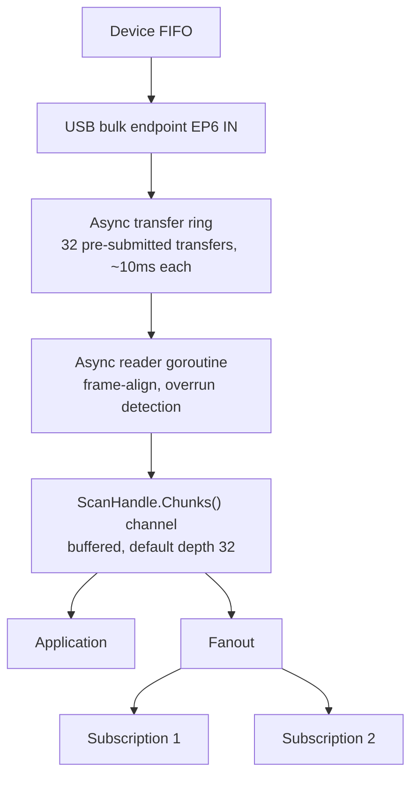

# Scanning Pipeline

This document describes how scan data flows from the USB-1808 hardware to
application code. For the user-facing API see [Analog Input](analog-input.md).

## Overview



## Hardware Setup

`CreateScan` configures the device before any data flows:

1. **ADC setup** (`cmdADCSetup`): sends one byte per analog channel encoding
   the voltage range (bits 0-1) and input mode (bits 2-3).
2. **Scan queue** (`cmdAInConfig`): loads up to 13 channel indices into the
   FPGA scan queue. The queue can mix analog inputs, digital I/O, counters,
   and encoders.

No data moves yet. The returned `ScanHandle` holds the configuration and a
buffered `chunks` channel.

## Starting a Scan

`ScanHandle.Start()` does four things in order:

1. Clears the device FIFO (`cmdAInClearFIFO`).
2. Creates an async bulk transfer ring on EP6 IN. The ring pre-submits 32
   libusb transfers, each sized by `ringStageSize` (see below).
3. Sends the `cmdAInScanStart` control transfer with the pacer period,
   scan count, and option flags.
4. Launches the async reader goroutine.

## Async Transfer Ring

The ring keeps the USB controller continuously armed with pending transfers
so there is no dead time between completions. When a transfer completes:

1. The data is copied into a Go-managed slice.
2. The transfer is immediately resubmitted.
3. The copy is delivered via a results channel to the reader goroutine.

### Buffer sizing (`ringStageSize`)

Each transfer targets ~10ms of data:

```
scans       = max(rate * 0.01, 1)
totalBytes  = min(scans * nChannels * 4, 16384)
```

The result is aligned down to `MaxPacketSize` (512 bytes), with a minimum of
one packet, then aligned to a frame boundary. This keeps transfers large
enough for efficient USB throughput while staying small enough for low
latency.

## Async Reader Goroutine

`runAsyncReader` sits in a loop over the ring's results channel:

1. **Frame alignment**: truncates each transfer to a whole number of frames
   (`nChannels * 4` bytes per frame).
2. **Finite scan clamping**: for counted scans (`Count > 0`), trims the last
   transfer so total frames do not exceed the requested count.
3. **Chunk delivery**: sends a `Chunk{Data, FrameStart, FrameCount}` on the
   `chunks` channel. `FrameStart` is a running frame counter so consumers
   can detect gaps.
4. **Overrun detection**: on transfer error, reads the device status register.
   If the FIFO overrun bit is set, stops the scan, clears the FIFO, and
   reports `ErrScanOverrun`.

A watchdog timer guards finite scans: if the expected duration plus 5 seconds
elapses without completion, the scan is force-stopped.

## Data Format

Each frame is `nChannels * 4` bytes of packed little-endian uint32 values, in
scan-queue order. Analog channels contain raw 18-bit ADC codes in the low 18
bits. Digital, counter, and encoder channels use their native uint32 values.

Calibration is never applied during scanning -- it happens later via the
`codec` package or `capture` reader.

## Buffering Layers

| Layer              | Depth           | Purpose                          |
|--------------------|-----------------|----------------------------------|
| Device FIFO        | Hardware         | On-chip sample buffer            |
| Transfer ring      | 32 transfers    | Keeps USB controller armed       |
| Chunks channel     | 32 (default)    | Decouples USB reads from app     |
| Fanout subscribers | Configurable    | Per-consumer isolation           |

If any layer fills up, the effect depends on where:

- **Device FIFO full**: hardware overrun (`ErrScanOverrun`), scan stops.
- **Chunks channel full**: the reader goroutine blocks, which stalls the ring,
  which can cause the device FIFO to fill.
- **Subscriber full**: that subscriber drops chunks; others are unaffected.

## Fan-Out

For multiple consumers (e.g. disk + live display), use `stream.Fanout`.
It reads from `Chunks()` and copies each chunk to independent subscriber
channels. See [Stream](stream.md) for details.

## Stopping

`ScanHandle.Stop()` closes the stop channel, which triggers:

1. `cmdAInScanStop` is sent to the device.
2. The ring is stopped (pending transfers cancelled).
3. The reader goroutine drains and exits.
4. The `chunks` channel is closed.

After `Stop`, `ScanHandle.Err()` returns any error that occurred during the
scan (typically `nil` or `ErrScanOverrun`).
